# eddy

A flow field for the terminal, drawn in my [glass](https://github.com/rashedInt32/glass) palettes.

Particles drift through a slowly turning curl-noise field and leave fading
trails, packed into braille dots and coloured along an OKLab ramp built from
one of the palettes. Zero dependencies, Bun + TypeScript, runs in tmux.

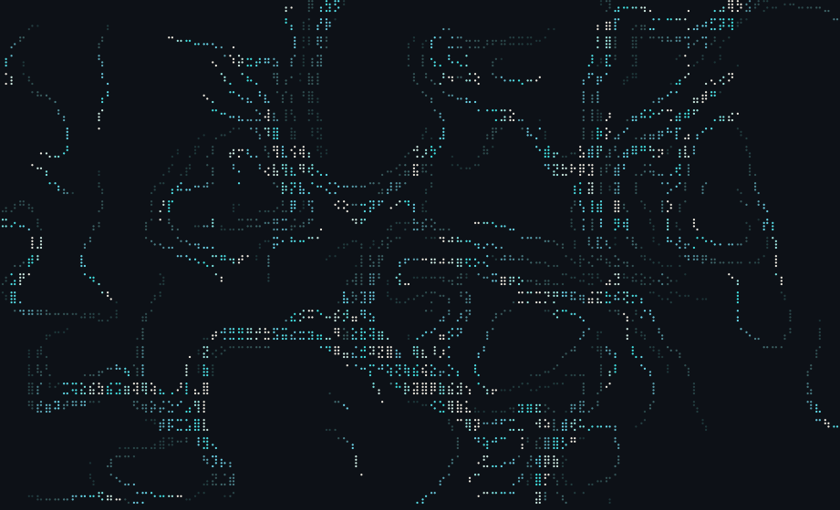

## run

```sh
bun src/main.ts                 # lagoon
bun src/main.ts -p ironbow      # one of: lagoon iris tarnish overprint ironbow tidepool water crimson tangerine prism
bun src/main.ts -c 20           # move to the next palette every 20 s
bun src/main.ts --once          # print one frame and exit
bun src/main.ts --once --svg frame.svg
```

Keys: `q` or `esc` quits, `space` pauses, `n` / `p` or the arrows change the
palette, `+` / `-` change the particle count, `r` reseeds the field.

To have it on your path:

```sh
ln -s "$PWD/bin/eddy" ~/.local/bin/eddy
```

## how it draws

- The field is the curl of two octaves of 3D simplex noise, so the flow is
  divergence-free: particles swirl in eddies and never pile up into sinks.
  The third noise axis is time, so the eddies themselves wander.
- Each particle deposits its head into an intensity grid at two dots per
  column and four per row. The grid fades a little every tick; that is the
  trail.
- A cell lights the dots above a threshold and takes the colour of its
  brightest dot, read off a 64-step ramp interpolated in OKLab between the
  palette's card tint, its rule grey, its secondary, its lead and its heading
  white. OKLab keeps a cyan-to-pink ramp from dipping through grey.
- A frame is one string, written in one call, with a colour code only where
  the colour changes along a row. A 200x50 terminal costs about half a
  millisecond per frame.

## under the terminal: the Ghostty shader

The same field as a GPU shader that runs behind everything in Ghostty, including
Claude Code, tmux and nvim, without touching any of them. It tints only pixels
that still show the terminal's background colour, so glyphs are left exactly
as rendered. It draws the way the TUI does: small dots on a lattice, lit where
a filament of the flow passes, in the palette's muted middle. Slow drift, lots
of dark between the dots, and every dot breathes on its own phase, with a few
at a time peaking into a brief glow. Under `prism` each glowing dot draws its
own colour from the starship set for that breath, so neighbours glow in
different hues over a grey-blue rest.

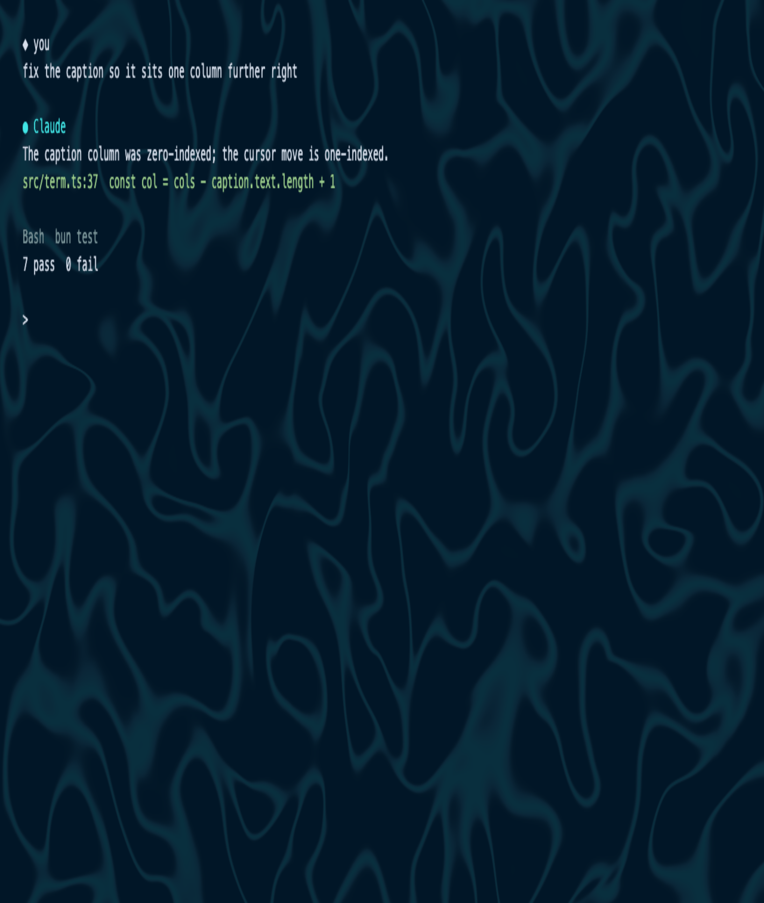

Add to `~/.config/ghostty/config` and reload (`super+shift+r` here):

```
custom-shader = ~/Documents/codes/packages/eddy/shaders/eddy-lagoon.glsl
custom-shader-animation = true
```

One file per palette lives in `shaders/`. Knobs sit at the top of each file:
`ALPHA` is how bright a lit dot is, `SPARSE` how much of each filament stays
dark, `PITCH` how fine the dot lattice is, `SPEED` how fast it drifts, `SCALE`
how many eddies fit on screen. Edit the template in `scripts/shader-template.glsl` and
run `bun run shaders` to rebuild all ten.

Things to know:

- `custom-shader-animation` must be `true` for motion. `always` keeps it moving
  when the window is unfocused, at some CPU cost. `false` means it only
  redraws when the terminal does.
- The shader applies to the whole Ghostty window, every tab and pane.
- It reads Ghostty's `iBackgroundColor` uniform, so it needs Ghostty 1.2 or
  newer and follows whatever theme you use.
- It works under every `alpha-blending` mode. Ghostty hands the shader a
  linear-light texture under `linear` and `linear-corrected` but an sRGB
  background uniform; the shader detects which space the texture is in per
  pixel, compares in sRGB, and blends in sRGB, so the field looks the same
  either way. `bun scripts/preview.ts` checks both: add `&linear=1`.
- Anti-aliased glyph fringes within about 10/255 of the background are tinted
  along with the background, which is what keeps glyphs from getting a halo.
  Anything brighter than that is untouched.

`bun scripts/preview.ts` serves a browser stand-in at `localhost:8765/?p=lagoon`
that runs the shader over a fake terminal and reports how many glyph pixels
changed and how much of the background was tinted.

## palettes

The hexes are glass's own; the ramps are eddy's. Same seed, same frame.

<table>
<tr><td>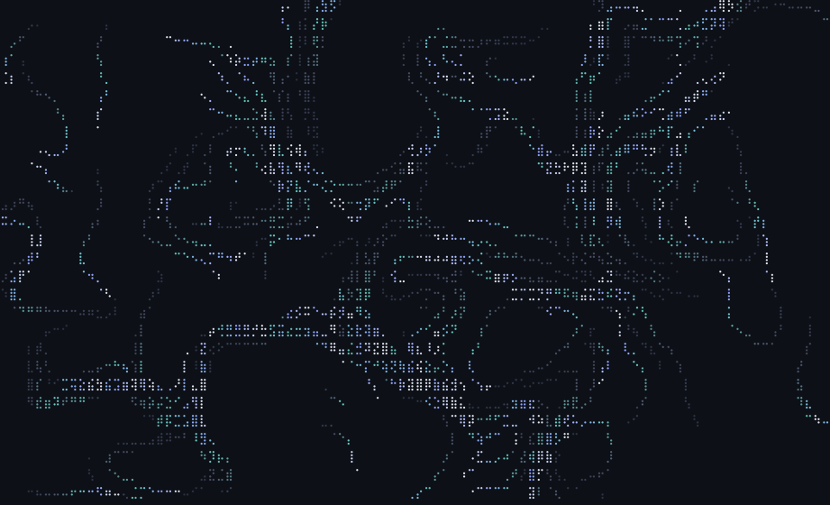</td><td>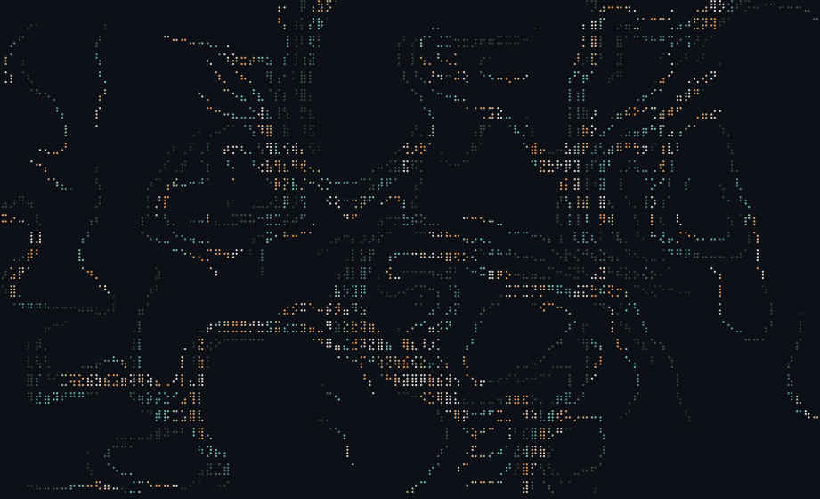</td></tr>
<tr><td align="center">iris</td><td align="center">tarnish</td></tr>
<tr><td>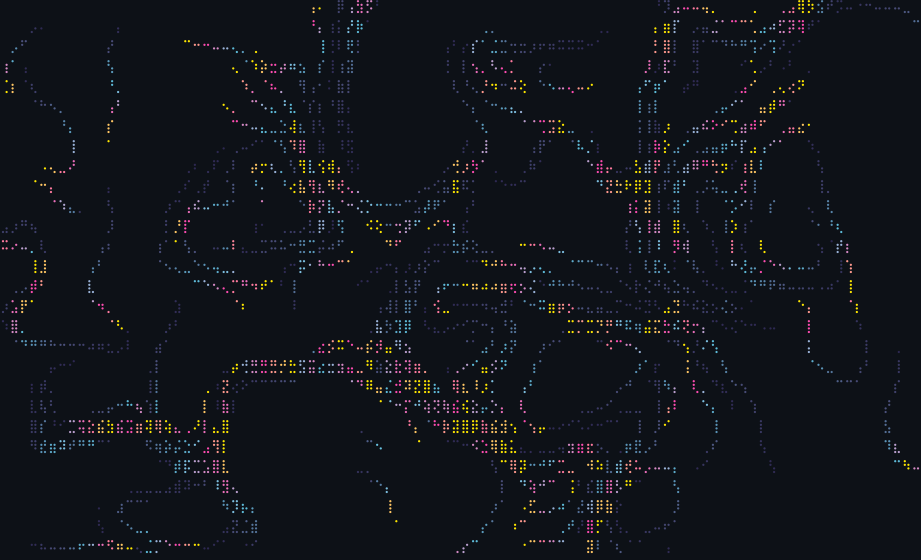</td><td>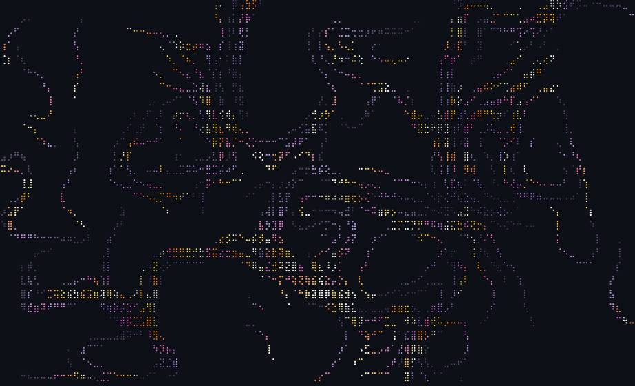</td></tr>
<tr><td align="center">overprint</td><td align="center">ironbow</td></tr>
<tr><td>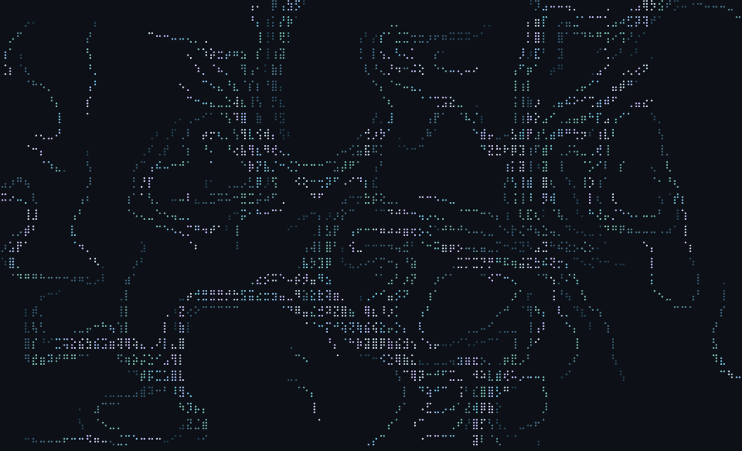</td><td>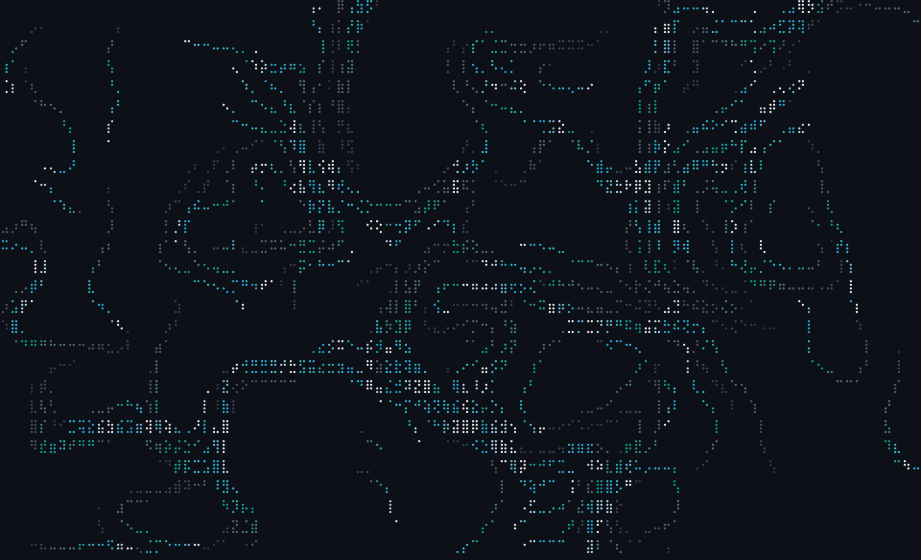</td></tr>
<tr><td align="center">tidepool</td><td align="center">water</td></tr>
<tr><td>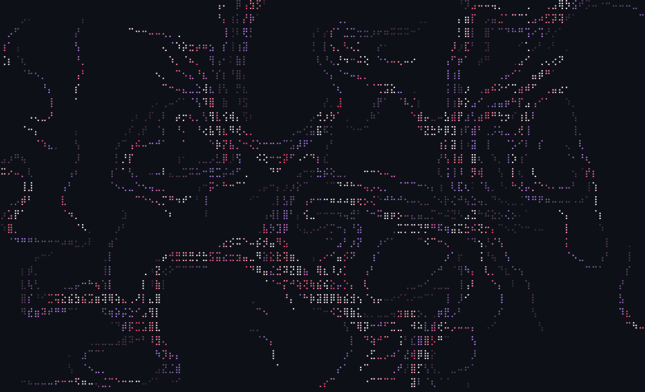</td><td>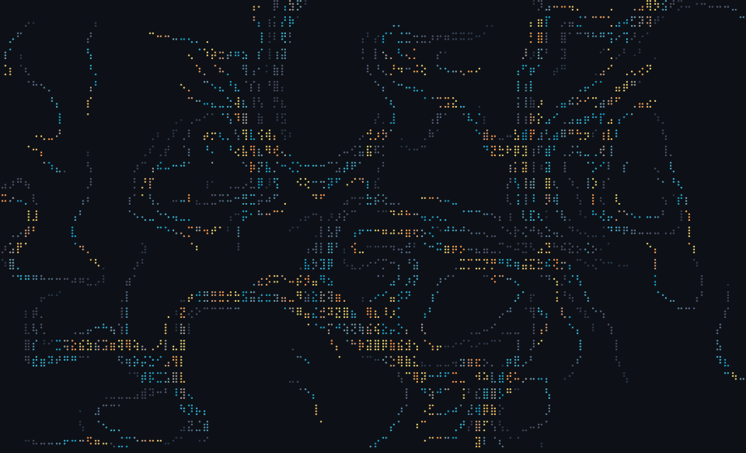</td></tr>
<tr><td align="center">crimson</td><td align="center">tangerine</td></tr>
<tr><td>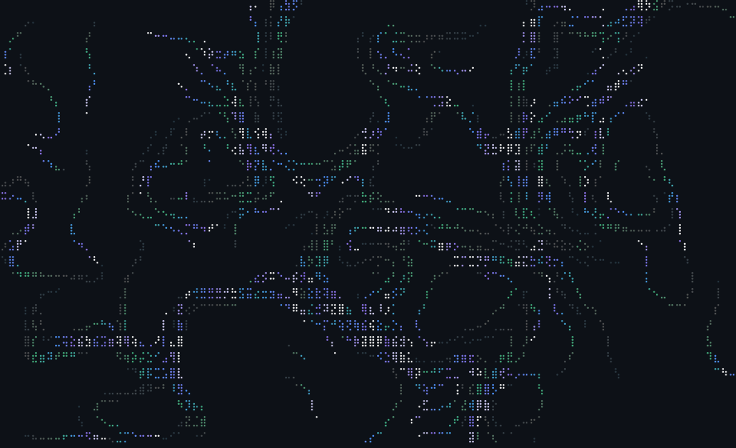</td><td></td></tr>
<tr><td align="center">prism</td><td></td></tr>
</table>

Regenerate the gallery with `bun run shots`.

## develop

```sh
bun test
bun run typecheck
```

## credit

Claude built this unprompted when I asked it to make whatever it wanted.
The simplex noise follows Stefan Gustavson's public-domain reference; the
OKLab conversion is Björn Ottosson's.

MIT
